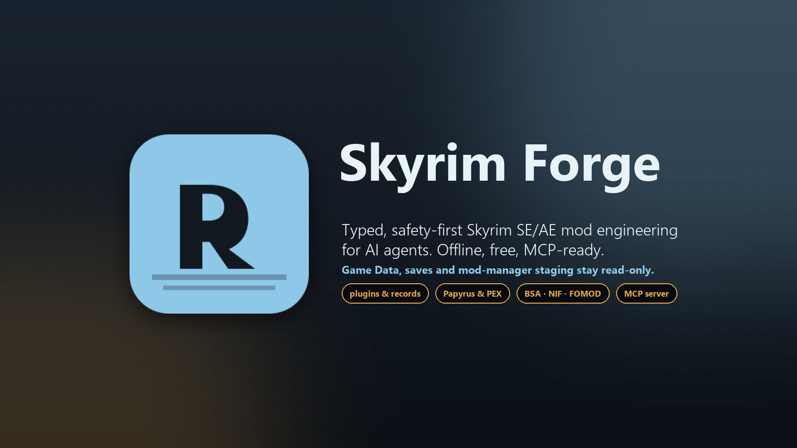
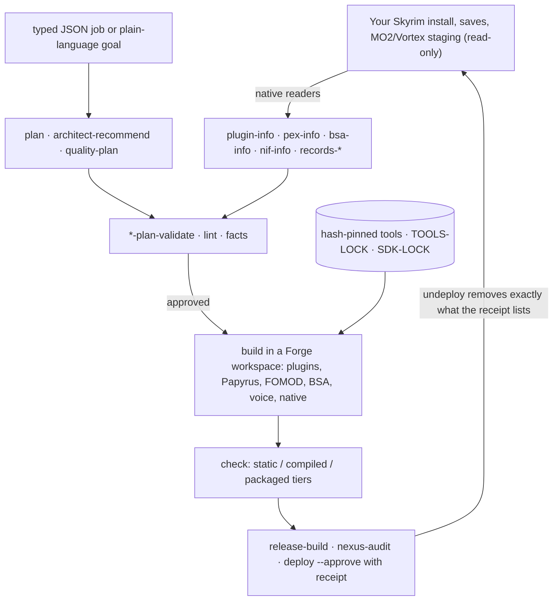

<div align="center">



# Skyrim Forge 6.13.1

[](https://github.com/SenjuWoo/SkyrimForge/actions/workflows/ci.yml)
[](https://github.com/SenjuWoo/SkyrimForge/releases/latest)
[](pyproject.toml)
[](docs/MCP.md)
[](LICENSE)

**[Install](#install)** · **[Tour](#a-short-tour)** · **[Commands](#what-it-does)** · **[Skill pack](#skill-pack)** · **[How it works](#how-it-works)** · **[Docs](#docs)** · **[Changelog](CHANGELOG.md)**

</div>

Skyrim Forge is a local workbench and MCP server that lets an AI build Skyrim SE/AE mods without clicking through SSEEdit, the Creation Kit, Wrye Bash, LOOT or Mod Organizer 2. A job is typed JSON: Forge validates it, runs only hash-pinned adapters, reopens what it can verify, and reports exactly what was and was not proven.

It runs **outside** the game and never installs into `Data`. Live game files, saves, MO2/Vortex staging and profiles are read-only inputs; every write lands in a Forge workspace behind an explicit approval. It is not the in-game SKSE C# framework at [docs.skyrimforge.net](https://docs.skyrimforge.net/).

## What you get

- **Answers read from your own install.** Plugin headers, records, FormIDs, load order and conflicts come from Forge's own parser; compiled scripts, BSA archives and NIF meshes are read natively with the standard library. Nothing is guessed from a wiki.
- **One command line, JSON out.** 115 CLI commands, each printing one JSON object with stable exit codes (0 ok, 1 findings, 2 a named failure, 3 a bug). `capabilities` lists them all from the parser.
- **An MCP server for any AI client.** 75 annotated tools on MCP `2026-07-28` plus the older `initialize` handshake, and a four-tool compact surface for hosts with a server-slot or token ceiling.
- **Writes you can undo.** Plugins, FOMODs, releases and test deploys go to a workspace or behind `--approve`, with receipts that list every file and its SHA-256.
- **Evidence tiers that never lie.** Static, compiled and packaged results are labelled separately; runtime is reported as not run, because nothing here starts Skyrim.
- **A 50-skill Skyrim SE/AE pack** for Claude, Codex, Grok, Kimi, Hermes and Antigravity, shipped inside this repository.


## Install

| Path | What happens |
|---|---|
| **Standalone** | Download `Skyrim-Forge-<version>.zip` from [Releases](https://github.com/SenjuWoo/SkyrimForge/releases/latest), check it against `SHA256SUMS.txt`, extract it, rename the folder to something stable such as `SkyrimForge`, then run `START-HERE.bat` inside it. That folder **is** the install root. |
| **With the bundle** | The [Ultimate AI Starter Bundle](https://github.com/SenjuWoo/Ultimate-AI-Starter-Bundle) extracts the latest digest-verified release to `%LOCALAPPDATA%\Skyrim-Tools\Skyrim-Forge`, never downgrades a newer local install, and puts the same CLI on PATH as `skyrim-forge`. |

Setup bootstraps a durable Python runtime, installs the Forge skill and the 50-skill Skyrim pack into every detected AI app, and registers the MCP server. It needs no admin rights. Re-running `START-HERE.bat`, `Update Forge.bat` or `Install-or-Update.ps1` updates that same folder in place, so a version-stamped extraction folder is safe as long as you keep its name: every AI client stores the MCP command as an absolute path. `SKYRIM_FORGE_ROOT` records the folder for other processes.

```powershell
.\forge doctor            # core health, venv durability, tool readiness
.\forge capabilities      # every command, plus direct / profiled / adapter / worker / human-gate levels
```

`forge.cmd` beside the install runs the bundled interpreter, so no PATH edit or venv activation is needed. `Forge Doctor.bat` opens the same report.

`forge doctor` reports separate readiness levels: `read_only_ready`, `plugin_write_ready`, `xedit_automation_ready`, `mo2_automation_ready`. A missing external tool does not make the core install broken. External tools and UI automation stay off until you enable them in `config.toml`.

## A short tour

`<Data>` is your game's `Data` folder; Forge only reads it.

```powershell
.\forge doctor                                        # what is ready, what is missing
.\forge plan "make a new quest with a start game enabled quest script"   # route a goal to commands
.\forge facts pex                                     # tiered facts and the command that re-reads each
.\forge plugin-info "<Data>\Update.esm"               # header, masters, record count
.\forge pex-info "<Data>\Scripts\actor.pex"           # compiled script header and objects
.\forge bsa-info "<Data>\Skyrim - Meshes0.bsa"        # archive layout, parsed natively
.\forge architect-recommend request.json              # rank the smallest suitable route
.\forge check "<mod folder>"                          # every applicable validator, by evidence tier
```


## What it does

| Capability | Command surface | Evidence |
|---|---|---|
| Plugin headers, records, FormIDs, load order, conflicts | `plugin-info`, `record-query`, `load-order`, `record-conflicts` | Forge parser; not xEdit |
| Typed plugin output (KYWD/GLOB/FLST/OTFT) | `plugin-plan-validate`, `plugin-build` | Transactional workspace writes |
| Papyrus analysis and compile | `papyrus-analyze`, `papyrus-compile` | Official compiler; fresh PEX verified, not runtime |
| SPID / KID / BOS / SkyPatcher / CDF lint and build | `lint`, `framework-plan-validate`, `framework-build` | Source-locked grammar; unknown tokens stay unverified |
| Static findings vs framework logs | `framework-correlate-logs` | `RUNTIME_VERIFIED_PASS` only for a named file and row |
| FOMOD 5.0 generation and simulation | `fomod-*` | Every `SelectExactlyOne`/`SelectAtMostOne` branch extracted into an MO2/Vortex-shaped sandbox; other group types are reported as uncovered, never claimed as tested |
| Archives, release trees, deterministic ZIPs | `bsarch-*`, `release-*` | Payload hashes and manifest |
| Nexus publication gate | `nexus-*` | File-level rights, credits, licences, AI disclosure; the uploader signs |
| Voice containers and generation | `audio-*`, `voice-generate`, `voice-path-validate` | Container bytes; WAV -> XWM + LIP -> FUZ with the Creation Kit's own encoder and lip generator; playback not tested |
| Typed records through Mutagen | `worker-build`, `records-find/show/override/new/conflicts/overlap/validate/index` | Forge-built .NET worker; new quests with a script and Start Game Enabled without opening the Creation Kit |
| Plugins as YAML | `spriggit-export`, `spriggit-build`, `spriggit-roundtrip` | Pinned Spriggit; record-equal round trip |
| Native BSA archives, PEX, NIF | `bsa-info/extract/pack`, `pex-info`, `papyrus-check`, `nif-info`, `nif-refs`, `nif-blender` | Standard-library readers; one diagnostics format for two Papyrus compilers; headless PyNifly |
| Papyrus decompile | `champollion-decompile` | Pinned Champollion; options read from the configured build's own help |
| Test deploys and Creation Kit jobs | `deploy`, `undeploy`, `ck-info`, `ck-run` | Dry run until `--approve`; receipts; exact undo |
| Evidence tiers, facts, routes, Nexus | `check`, `facts`, `plan`, `nexus-mod`, `nexus-find` | static / compiled / packaged; runtime is never claimed |
| Pinned toolchain | `tools-lock-status`, `tools-sync` | SHA-256-pinned assets; identical existing copies reused, so a second sync downloads nothing |
| SKSE DLL inspection | `skse-inspect-pe`, `skse-audit-imports`, `skse-verify-reproducible` | PE32+ bytes; never loaded |
| Native CommonLibSSE-NG projects | `native-scaffold`, `native-build`, `native-audit` | Source-locked scaffold, pinned tools |
| xEdit fixed scripts, LOOT, Wrye Bash, Creation Kit | `automation-*` | Allowlisted scripts or pinned workers; completion markers required |
| Procedural textures | `texture-generate`, `texture-inspect` | DDS bytes and a PNG preview |
| Cleanup and drift detection | `maintain` | Forge-owned paths only; dry-run by default |

## Mod intelligence

Before writing files, ask Forge to rank the smallest suitable route:

```powershell
.\forge architect-recommend request.json
.\forge knowledge-status
.\forge quality-plan --types papyrus,native
```

`architect-recommend` compares framework distribution, record patches, Papyrus,
native plugins, UI, animation, assets, LOD and packaging, and returns open
questions plus verification steps. `knowledge-status` reports curated source
pins and local probe presence without pretending a detected file proves a
version. `quality-audit` keeps a missing runtime check `UNVERIFIED` instead of
turning it into a pass; only known verifier receipts bound to the report subject,
dimension and scope produce a verified `PASS`, and a general repository report
cannot verify unrelated dimensions. See [docs/MOD-INTELLIGENCE.md](docs/MOD-INTELLIGENCE.md).

## Free assets

`texture-generate` writes deterministic DDS files (BC1, BC3 or A8R8G8B8, full mip chains) from solid, checker, gradient, seeded-noise, brick and tangent-space-normal patterns, with an optional PNG preview. No paid tool, no network, no new dependency.

```powershell
.\forge texture-generate bricks mod/Textures/Stone.dds --size 512 --preview mod/Stone.png --approve
.\forge texture-generate normal mod/Textures/Stone_n.dds --strength 0.12 --flip-green --approve
```

Meshes stay with Blender, hand art with GIMP or Krita, BC7 with `texconv`. [docs/ASSET-GENERATION.md](docs/ASSET-GENERATION.md) maps every remaining gap to a free tool and its licence.

## Skill pack

Forge owns the **50-skill Skyrim SE/AE pack** (`integrations/skyrim-pack/`): router, memory, versioned workspace, SPID/KID/SkyPatcher/OAR/CDF grammar, Papyrus, NIF/DDS, FOMOD, Nexus publishing, diagnostics and houseCARL. It ships **inside this repository**, so a standalone Forge install gets the whole pack without the bundle.

```powershell
.\Install-Skyrim-Pack.ps1 -Provider All -WithHouseCarl
```

The pack's `skyrim-tooling-stack` decides between Forge, houseCARL and external tools. `houseCARL 2.1.2` setup and the Vortex load-order shim live at `integrations/skyrim-pack/skills/housecarl/scripts/Setup-HouseCarl.ps1`.

## How it works



- **Read roots are enforced.** A path outside the configured game, staging and workspace roots is refused, not read.
- **Writes need approval.** Every writing command needs `--approve` (MCP: `approved: true`) and lands in the workspace; only `deploy`, `undeploy` and `ck-run` touch the game folder, and they keep receipts.
- **External tools are pinned.** Each adapter selects a tool by exact capability and SHA-256; nothing third-party ships in this repository or a release. Subprocesses use argument arrays and `shell=False`.
- **Facts carry sources.** Routes, Nexus page IDs and format facts live in `references/` with a tier and the command that re-reads them; only installed and primary facts are enforced.

## Maintenance and updates

```powershell
.\forge maintain                        # report stale Forge-owned files, moved and stale roots
.\forge maintain --apply --approve      # delete the reported leftovers
.\forge maintain --fix-roots --approve  # write discovered paths into config, drop stale read roots
```

`maintain` removes only paths Forge can prove it owns: spill files and sandbox runs older than a week under `<workspace>\.forge`, and provider skill backups beyond the newest two. It reports the self-test, flags configured roots that moved with the discovered replacement, and never touches a mod, a tool install or a user file. See [docs/MAINTENANCE.md](docs/MAINTENANCE.md).

Updates are explicit: `Update Forge.bat` or `Update-Forge.ps1 -CheckOnly`. The updater verifies the release digest, keeps the newest two backups and rolls back on any failure. A weekly **Ecosystem contract check** verifies the bundle's `skyrim-forge` catalog entry, this repository's release assets and Reverse THIS!'s receipt shape without copying either project's version.

## MCP

Forge serves the current **MCP `2026-07-28`** revision and the `initialize` handshake older clients still use, from one process. The full surface exposes 75 tools with annotations; `--surface compact` exposes four orthogonal tools for hosts with a server-slot or token ceiling. Oversized results spill to a workspace artifact instead of being truncated, and Grok's 8-server limit is handled by skipping registration rather than taking the last slot. The newest commands (records worker, Spriggit, native BSA/PEX/NIF, voice, deploy, Creation Kit) are CLI-only so far. See [docs/MCP.md](docs/MCP.md).

## Safety and evidence

- Live `Data`, saves, profiles, archives and manager staging are read-only; outputs stay in the workspace.
- Writes require explicit approval; subprocesses use argument arrays and `shell=False`.
- External tools are selected by exact capability and a SHA-256 pin; nothing third-party ships in this repository or a release.
- Static checks, compiler acceptance, PE parsing and xEdit output are labelled separately from Skyrim runtime evidence.
- No check in this repository claims that a mod works in game.

[docs/SAFETY.md](docs/SAFETY.md) · [docs/LIMITATIONS.md](docs/LIMITATIONS.md) · [docs/CAPABILITY-MATRIX.md](docs/CAPABILITY-MATRIX.md)

## Docs

| Doc | Contents |
|---|---|
| [INSTALLATION](docs/INSTALLATION.md) | install roots, venv durability, provider registration |
| [MCP](docs/MCP.md) | surfaces, protocol eras, bounded output, registration |
| [MAINTENANCE](docs/MAINTENANCE.md) | cleanup rules, root drift, weekly upkeep |
| [AGENTS](AGENTS.md) | preflight, edit/test loop, release runbook for AI agents |
| [TOOLCHAIN-BROKER](docs/TOOLCHAIN-BROKER.md) | hash-pinned tools, vault, capability matching |
| [ASSET-GENERATION](docs/ASSET-GENERATION.md) | procedural DDS and the free-tool map |
| [AUDIO-ENGINEERING](docs/AUDIO-ENGINEERING.md) | FUZ/XWM/WAV/LIP, voice layout |
| [PAPYRUS-ENGINEERING](docs/PAPYRUS-ENGINEERING.md) | analysis and compile evidence |
| [NEXUS-PUBLICATION](docs/NEXUS-PUBLICATION.md) | the rights and publication gate |
| [WHICH-AI-SHOULD-I-USE](docs/WHICH-AI-SHOULD-I-USE.md) | task-to-assistant routing |
| [prompts](docs/prompts/README.md) | copy-paste Skyrim prompt packs |

## Status

CI runs Python 3.11/3.13/3.14 on Windows and Ubuntu, the native writer on both, a reproducible repository gate, CodeQL and the Windows installer/legacy-migration path. Releases are built from the exact commit whose checks passed and carry `MANIFEST.json`, `SBOM.spdx.json`, `BUILD-RECEIPT.json`, `VALIDATION.json` and `SHA256SUMS.txt`.

Not claimed: gameplay results, in-game visuals, or that any static check replaces a real Skyrim session. The [CHANGELOG](CHANGELOG.md) and [STATE](STATE.md) record what each release actually verified.

## License

Forge is MIT licensed ([LICENSE](LICENSE)). The bundled houseCARL-derived skills keep their own GPL-3.0 licence and notices (`integrations/skyrim-pack/skills/housecarl/LICENSE`, `THIRD-PARTY-NOTICES.txt`). Ownership across Forge, the bundle and Reverse THIS! is stated once in the [bundle README](https://github.com/SenjuWoo/Ultimate-AI-Starter-Bundle#ownership). The screenshots show real output from a local install; the game files they inspect belong to their owners and are not redistributed.
